# Project subagents

A map of the subagents in this folder: what each one does, which tools it may use, and what it takes
in and hands back. The rules themselves live in each agent's own `.md` file — read that before
changing or relying on a detail.

```mermaid
flowchart LR
    B["brief + design sources<br/>text, Figma, screenshots, code"] --> SC[spec-creator]
    SC -- "SPEC: NEEDS_INPUT" --> SU["user answers<br/>asked by the main session"]
    SC -. "Needs research" .-> R
    SU -. "SendMessage: answers + reports" .-> SC
    SC -- "SPEC: DRAFTED" --> SP["specs/ or a package specs/<br/>approved by the user"]
    SP --> P
    Q[external question] --> R[researcher]
    T[task or brief] --> P[implementation-planner]
    R -. facts .-> SC
    R -. facts .-> P
    P -- "questions" --> U["user answers<br/>asked by the main session"]
    U -. "SendMessage: answers" .-> P
    P -- "writes" --> F[".devdigest/plans/NN-slug.md<br/>plan.mjs lint · approved by the user"]
    F --> IMP
    subgraph IMP ["/run-plan plan: … (run by the user)"]
        I["implementer, one run per phase<br/>reads plan.mjs slice of its phase"] --> V["scripts/verify.mjs<br/>one full test run"]
        V --> PV[plan-verifier]
        V --> AR[architecture-reviewer]
        V --> CR["code-review skill<br/>correctness"]
        PV --> LG["ledger NN-slug.review.md<br/>triage: fix · ask · reject"]
        AR --> LG
        CR --> LG
        LG -- "open fixes: amendment Phase Fk" --> FX["implementer Fk → verify"]
        FX -- "delta re-review<br/>tree-snapshot scope · rows:" --> PV
        LG -- "nothing open" --> L["live check<br/>main session runs the feature"]
        L --> D[doc-writer]
    end
    D --> S["/pr-self-review<br/>run by the user"]
```

Three entry points, each started by the user: `spec-creator` (optional), `implementation-planner`, and
`/run-plan` ([`../skills/run-plan/SKILL.md`](../skills/run-plan/SKILL.md)), which runs everything after
the plan. The agents never call each other (`Agent` is denied to all of them). Subagents do not see the
conversation. Pass work as a **file path** (a plan, a saved report) or as a self-contained question, never
as "the plan above". `test-writer` is not part of `/run-plan` (token budget); run it by hand.

The planner cannot ask the user anything itself. The main session asks every question from the plan's
summary with `AskUserQuestion`, and the first one is always the **execution mode**:
- **multi-agent**: `/run-plan` runs implementer phases, review and fix rounds, the live check and `doc-writer`;
- **single-agent**: the main session implements the whole plan itself, with no subagents.

`/pr-self-review` is mandatory in both. Answers that change the plan go back to the same planner run
through `SendMessage`, so it does not redo its research.

`spec-creator` works the same way. Its first run writes nothing: it returns blocking questions,
proposals and "Needs research" items. The main session asks the user, runs one `researcher` per research
item (in parallel when they are independent) and continues the same `spec-creator` run with the answers
and reports. Only then does it write the draft spec.

`plan-verifier`, `architecture-reviewer` and the correctness review (`code-review` skill) are independent
and run in parallel. Their findings go into one ledger; `/run-plan` fixes CRITICAL / WARNING / NOT MET
automatically, asks about SUGGESTIONs and anything that changes scope or a contract, and re-reviews only
what the fix round changed (`scripts/tree-snapshot.mjs` → `scope:`, verifier `rows:`). After 3 rounds, an
oscillating finding or no progress it stops and asks. If you run `test-writer` by hand, run it AFTER
`plan-verifier`, only for its "Rows without test evidence": tests written before the verifier land on
missing code (false `BUG FOUND`) or on code a review fix is about to move.
`architecture-reviewer` checks boundaries only; bugs come from the correctness review and the live check
(both L05 bugs — Windows `\` paths giving 0 callers, long paths overflowing the card — were found by
running the feature, not by an agent).

**Token budget.** Measured on L03–L05 transcripts: what costs is the context re-sent on every turn
(70–100K tokens per implementer turn: the whole plan plus preloaded skills), not test output (~5% of the
implementer's tool results). So the pipeline keeps per-turn context small and turns few:
- `researcher` is for external facts; the `implementation-planner` researches the code itself.
- The planner writes the plan file and returns only `## Summary for the caller`, so neither the planner
  nor the main session re-types a 40 KB plan. `plan.mjs lint` enforces body ≤ 24 KB (target 20).
- The `implementer` runs once per phase with a fresh context and reads only `plan.mjs slice <plan>
  <phase>` (about half of a plan); nothing is preloaded, it invokes the skills its files need.
- Tests: a step runs its own test files, a phase its lanes once; the full run of every package is one
  `scripts/verify.mjs` call by the main session, and `plan-verifier` cites its fingerprinted JSON instead
  of re-running suites.
- Reviewers get `diff-index:` (from `node scripts/diff-index.mjs`) and `base: origin/main`, and read
  per-file diffs only for the files their rules cover; `plan.mjs files` answers the verifier's file rows.
- `plan-verifier` puts failing rows and test gaps before the full table; MET rows are compact.
- `implementer`, `plan-verifier` and `architecture-reviewer` write their full reports to files (`out:`)
  and return only a head, so the orchestrating main session — alive through every round — stays small.
- Only `spec-creator` and `implementation-planner` run on `opus`; the agents that run every round are on
  `sonnet` (`/run-plan verifier:opus` for a schema or shared-contract plan).

## At a glance

| Agent | Responsibility | Model | Can change files? | Input → output |
|---|---|---|---|---|
| [`spec-creator`](spec-creator.md) | Writes a draft spec from the user's sources; finds design gaps, edge cases and UX improvements | `opus` | yes, spec files only (prompt rule, no hook) | brief + sources → questions, then `SPEC: DRAFTED` |
| [`researcher`](researcher.md) | Answers ONE concrete question about the repo or the outside world | `sonnet` | no | question → research report |
| [`implementation-planner`](implementation-planner.md) | Checks the requirements and turns a task into an Implementation Plan; never writes specs | `opus` | its plan file only (`agent-guard planner`) | task / brief / spec → plan file + summary with questions for the user |
| [`implementer`](implementer.md) | Executes one phase of an approved plan and proves it with targeted tests | `sonnet` | yes, only the plan's files, never from Bash | plan path + phase → implementation report |
| [`test-writer`](test-writer.md) | Writes tests for the verifier's test gaps and proves each one can fail — manual, not in `/run-plan` | `sonnet` | yes, test files only | verifier report / plan path / behaviours → `TESTS:` report |
| [`plan-verifier`](plan-verifier.md) | Traces every plan item and requirement to code and evidence | `sonnet` | its report file only (`agent-guard reviewer`) | plan (+ spec, base, diff-index, verify, report, rows, previous) → `PLAN VERIFICATION:` head; table in `out:` |
| [`architecture-reviewer`](architecture-reviewer.md) | Checks a diff against the boundary rules (not bugs); in a fix round, only the round's files | `sonnet` | its report file only (`agent-guard reviewer`) | base (+ diff-index, scope, previous) → `ARCHITECTURE REVIEW:` head; report in `out:` |
| [`doc-writer`](doc-writer.md) | Documents what shipped, with diagrams | `sonnet` | yes, documentation only | plan / spec / materials → `DOCS:` report |

Only `plan-verifier` and `architecture-reviewer` review, each in its own lane (see "Lanes" below). None
of the agents opens PRs or commits. None of them writes to `INSIGHTS.md`: each one ends its
report with "Worth recording in INSIGHTS", and the main session records those entries through the
`engineering-insights` skill.

## spec-creator

- **Does:**
  - reads `AGENTS.md` and the `INSIGHTS.md` of the modules the feature touches only; greps the root
    `INSIGHTS.md` for the feature's keywords instead of reading it whole;
  - reads the sources: text, Figma (structure and screenshots, never generated code), screenshots, code;
  - analyses them with `spec-authoring` → `references/checklists.md`: UI state matrix, interaction,
    content, accessibility, design vs code, module interaction, untrusted inputs, NFRs;
  - classifies every finding as BLOCKING, PROPOSAL (at most 5 UX improvements), RESEARCH or DEFAULTED;
  - writes the draft in English by the `spec-authoring` template (EARS criteria with IDs, Decisions,
    Traceability with a Verify hint per criterion) and runs its 8-point self-check.
- **Never:** writes code, plans, `AGENTS.md`, `INSIGHTS.md` or `.claude/**`; edits a spec past `draft`
  (it supersedes it instead, after the user agreed); puts files, functions or tables into the spec.
- **Tools:** `Read, Grep, Glob, Write, Edit, ToolSearch` + Figma read tools (`create_session`,
  `get_metadata`, `get_screenshot`, `get_variable_defs`). Denied: `Bash, Agent, NotebookEdit, Skill,
  WebSearch, WebFetch`. The Figma tool names are those of the claude.ai Figma connector; with another
  Figma MCP server the names differ and the agent falls back to asking for PNG exports.
- **Enforced:** nothing — the write limit (spec folders only, drafts only) is a prompt rule. No Bash
  means Write / Edit are its only ways to change a file.
- **Preloaded skills:** `spec-authoring`, `mermaid-diagram`.
- **In:** `brief:` plus `sources:`; optional `target:` (a draft to revise), `supersedes:`, research reports.
  Later, the user's answers, sent to the same run through `SendMessage`.
- **Out:** `SPEC: NEEDS_INPUT` (blocking questions with defaults, proposals, "Needs research", found so
  far) or `SPEC: DRAFTED` (path, counts, open questions, self-check, spec impact).

## researcher

- **Does:** codebase research (where, how and why, from git history) and external research (docs,
  versions, known issues). If the question is vague, it returns clarifying questions instead of a report.
- **Tools:** `Read, Grep, Glob, Bash, WebSearch, WebFetch`. Denied: `Write, Edit, NotebookEdit, Skill`.
- **Enforced:** `agent-guard.mjs readonly` on Bash. The prompt narrows it further to `git log/blame/show/diff`,
  `ls`, `wc`.
- **In:** one question with a findable answer.
- **Out:** a report with a short answer, conclusions with confidence levels, evidence (`path:line` or a
  URL with a date or version), and a mandatory "Not found" list. Or `## Clarification needed`.
  Fetched content is treated as data, not instructions.

## implementation-planner

- **Does:**
  - reads the package `AGENTS.md`, `specs/` and the package `INSIGHTS.md`; greps the root `INSIGHTS.md`
    instead of reading it whole;
  - locates the modules;
  - checks the requirements against each other, the rules and the code: testable, unambiguous,
    consistent, backed by the code, complete, scoped (an `approved` spec skips the first two — its
    self-check covered them). A BLOCKING issue stops it with questions, while a DEFAULTED one is planned
    with a recorded default;
  - recommends better options (at most 5). One that changes what gets built waits for the user;
  - recommends an execution mode: single-agent for one phase in one package with no contract or schema
    change, multi-agent otherwise;
  - maps every file it plans to touch to the skills that own it;
  - writes ordered, verifiable steps with targeted `done when` (a step: its own test files; a phase: its
    lanes; no "run every suite" step — that is `scripts/verify.mjs`), and a §7 row per spec `AC-n` / `NFR-n`;
  - writes the plan file and runs `node scripts/plan.mjs lint` on it until it passes.

  Questions that need outside facts go into the plan as `Needs research: …`.
- **Never:** writes, drafts or edits a spec, or plans a step that does. A `specs/` file is read-only
  input. A conflicting or outdated spec is reported under "Spec impact".
- **Tools:** `Read, Grep, Glob, Bash, Write, Edit`. Denied: `NotebookEdit, Agent, WebSearch, WebFetch`.
- **Enforced:** `agent-guard.mjs planner` — Edit/Write only on a file directly under `.devdigest/plans/`;
  Bash on the shared read-only allowlist.
- **Preloaded skills:** `onion-architecture`, `frontend-ui-architecture`. It reads `postgresql-table-design`
  (schema changes), `mermaid-diagram` (a diagram), `spec-authoring` (a draft spec or a brief) and any other
  skill's `SKILL.md` as a document, only when the change needs it.
- **In:** `plan:` — the path to write — plus a task description, a brief or a spec file (`specs/`,
  `<package>/specs/`). Later, the user's answers, sent to the same run through `SendMessage`; it then
  edits only the sections they change.
- **Out:** the plan FILE, and a message `PLAN: READY · Path · Body · Phases · lint` followed by
  `## Summary for the caller` (the requirements check, the recommendations and the questions for the
  user, execution mode first) — or `PLAN: NEEDS_CLARIFICATION` with no file. The file's numbered sections:
  - §0 Scope, with assumptions, user decisions and the execution mode
  - §1 Context read
  - §2 Modules
  - §3 Constraints
  - §4 Skill map
  - §5 Steps (files from the repo root, skills, rules, `done when` command)
  - §6 Contracts & data
  - §7 Test plan (`AC-n / NFR-n → suite → test file › case → step`)
  - §8 Risks
  - §9 Handoff to reviewers

  `.devdigest/plans/` is git-ignored.

## implementer

- **Does:** reads only its phase's slice of the plan (`node scripts/plan.mjs slice <plan> <phase>`),
  executes it step by step and runs each step's `done when` — typecheck plus the step's own test files —
  with at most 3 fix attempts. At the end of the phase it runs that phase's lanes once (integration only
  when the phase touched DB code) and self-checks its diff against the plan. The full run of every
  package is not its job (`scripts/verify.mjs`, main session). A deviation that changes scope, a contract
  or the schema stops the step as `BLOCKED`.
- **Tools:** `Read, Grep, Glob, Edit, Write, Bash, Skill`. Denied: `Agent, NotebookEdit, WebSearch, WebFetch`.
- **Enforced, not just prompted:** the `PreToolUse` hook [`../hooks/implementer-guard.mjs`](../hooks/implementer-guard.mjs) denies:
  - state-changing git;
  - `gh pr`, `docker compose down`, recursive `rm`, `db:migrate` / `db:seed`;
  - file writes from Bash: output redirects, heredocs, `tee`, `sed -i` / `perl -i`, inline `node -e` /
    `python -c` scripts — files change only through Edit / Write, which the path rules can see;
  - edits to migrations, `server/clones/`, `.claude/`, `client/src/vendor/ui/` and any `INSIGHTS.md`.

  The hook fails open on its own errors.
- **Skills:**
  - None preloaded: it invokes through `Skill` what the plan's Skill map lists for the files it edits —
    `onion-architecture` for backend files, `frontend-ui-architecture` for client files — so a
    server-only or mcp-only phase never carries the 18 KB client skill.
  - `security` is mandatory whenever a changed file or added line matches its triggers in `routing.md`, even if the plan omits it.
- **In:** the path to a plan whose first line is `PLAN: READY`, and `phase:`. Any other plan is refused.
- **Out:** a message whose first line is `IMPLEMENTATION: DONE`, `PARTIAL` or `BLOCKED`. It has these sections:
  - Steps
  - Files changed
  - Skills applied
  - Verification (every command with its exit code and passed / failed / skipped counts)
  - Deviations
  - Not done / blockers
  - Handoff to reviewers

## test-writer

- **Does:** writes client component tests (Vitest + RTL), server unit / route (`app.inject`) /
  integration (`*.it.test.ts`, real Postgres) tests and reviewer-core engine tests; proves each new test
  can fail (red first, or a flip check of the expected value); runs the package lanes. A new test that
  fails because the code is wrong stays failing and is reported as `BUG FOUND`.
- **Tools:** `Read, Grep, Glob, Edit, Write, Bash, Skill`. Denied: `Agent, NotebookEdit, WebSearch, WebFetch`.
- **Enforced:** `agent-guard.mjs test-writer` — Edit/Write only on test files, including `mcp/test/**`. Never the
  gate tests `server/test/architecture.test.ts`, `reviewer-core/test/purity.test.ts`, `mcp/test/architecture.test.ts`,
  or `mcp/test/server-contract.test.ts`, which pins the user-approved MCP texts. Bash on the shared read-only allowlist.
- **Skills:** none preloaded. It invokes the skills `routing.md` gives each test file
  (`react-testing-library` for `client/src/**/*.test.tsx`) plus those of the production file under test.
- **In:** in the pipeline, `verifier:` — a `plan-verifier` report; it covers exactly its "Rows without test
  evidence". Also a `PLAN: READY` plan path, or explicit behaviours + scenarios. "Add tests for X" alone →
  `TESTS: NEEDS_CLARIFICATION`.
- **Out:** `TESTS: DONE | PARTIAL | BUG FOUND | BLOCKED` with tests written (red and green evidence),
  suspected bugs, skills applied, verification, changes to existing tests, not covered.

## plan-verifier

- **Does:** turns every plan item (§0 scope, each step's files / rules / `done when`, §6 contracts, §7
  tests), every spec criterion and every caller requirement into a row with verbatim text; finds
  implementation evidence (`path:line` + quote) and verification evidence (Test / Inspection / Analysis /
  Demonstration); reverse-traces changed files nobody asked for. The implementer's report is treated as
  unverified claims; a fresh `scripts/verify.mjs` record (checked with `--check`) is observed evidence, so
  it does not re-run the lanes. File rows come from `node scripts/plan.mjs files <plan> <diff-index>`.
- **Model:** `sonnet` — the mechanical parts are scripts now (file rows, `verify.json`, delta `rows:`), and
  the prompt rules leniency out ("partial evidence is never MET"). `/run-plan verifier:opus` overrides it.
- **Tools:** `Read, Grep, Glob, Bash, Write`. Denied: `Edit, NotebookEdit, Agent, Skill, WebSearch, WebFetch`.
- **Enforced:** `agent-guard.mjs reviewer` — Write only on its report `.devdigest/plans/<NN-slug>.r<k>.verifier.md`.
- **In:** `plan:` (required), optional `spec:`, `base:` (default `origin/main`), `diff-index:`, `verify:`,
  `report:`, `ignore:`, `brief:` (verbatim `U-n` rows), `out:`, and `rows:` + `previous:` for a delta
  re-check after fixes.
- **Out:** `PLAN VERIFICATION: PASS | FAIL | INCOMPLETE | BLOCKED` and a traceability table with
  `MET / PARTIALLY MET / NOT MET / DEVIATED / NOT VERIFIABLE / EXTRA`. The verdict is mechanical: any NOT
  MET, PARTIALLY MET or EXTRA → FAIL; else any NOT VERIFIABLE → INCOMPLETE; else PASS. No general advice.
  "Rows without test evidence" lists the AC / NFR / T rows proven only by inspection. With `out:`, the
  table goes to the file and the message is only the part above it.

## architecture-reviewer

- **Does:** runs the deterministic checks first (`pnpm arch`, the debt ledger diff, client
  `no-restricted-paths` lint output, `reviewer-core` purity test, `mcp` `npm run arch`, both `shared`
  copies, schema ↔ migration), then detects candidates against a fixed rule table (`R1`–`R13`, `ON-*`,
  `FE-*`, `X-*`, `MCP-ARCH`) and tries to disprove each one. Only survivors are reported; dropped
  candidates are listed with a reason. It does not look for bugs — that is the correctness review.
- **Model:** `sonnet` (the user's call, 2026-11-01): the deterministic checks carry the hard part.
- **Tools:** `Read, Grep, Glob, Bash, Write`. Denied: `Edit, NotebookEdit, Agent, Skill, WebSearch, WebFetch`.
- **Enforced:** `agent-guard.mjs reviewer` — Write only on its report `.devdigest/plans/<NN-slug>.r<k>.arch.md`.
- **Preloaded skills:** `onion-architecture`, `frontend-ui-architecture` — its rule sources on every run.
- **In:** `base:` (default `origin/main`), optional `diff-index:`, `plan:` (only its §2, to know the
  packages), `ignore:`, `out:`; in a fix round `scope:` (the files the round changed) and `previous:` (its
  last report).
- **Out:** `ARCHITECTURE REVIEW: CLEAN | FINDINGS | INCOMPLETE | BLOCKED`; each finding has rule id,
  severity (CRITICAL / WARNING / SUGGESTION from `finding-format.md`), quoted code, quoted rule,
  mechanism and the disproof attempt; with `previous:`, each earlier finding is `resolved`, `open` or
  `regressed`. With `out:`, the message is only the head with one line per finding.

## doc-writer

- **Does:** documents implemented behaviour only, checking every claim against `path:line`; gives each
  page one Diátaxis type and places it in the existing layout (package README sections, `<package>/docs/`,
  `docs/features/<NN-slug>.md` for cross-package features, ADRs in `<package>/docs/adr/` or `docs/adr/`);
  draws Mermaid `flowchart` / `sequenceDiagram` / `erDiagram` / `stateDiagram-v2` (never Mermaid C4,
  which is experimental); stamps each page `As of <sha>`.
- **Tools:** `Read, Grep, Glob, Edit, Write, Bash`. Denied: `Agent, NotebookEdit, Skill, WebSearch, WebFetch`.
- **Enforced:** `agent-guard.mjs doc-writer` — Edit/Write only on documentation; never `specs/`,
  `docs/agent-prompts/`, `docs/skills/`, `docs/improvement-plan.md`, `AGENTS.md`, `CLAUDE.md`, `INSIGHTS.md`.
- **Preloaded skills:** `mermaid-diagram`.
- **In:** a plan, a spec, a `plan-verifier` report and/or other materials. Rows that are not MET in the
  verifier report are not documented.
- **Out:** `DOCS: DONE | PARTIAL | BLOCKED | NEEDS_CLARIFICATION` with pages written, claims verified,
  not documented, spec divergences, proposed index / `AGENTS.md` rows for the main session.

## agent-guard

[`../hooks/agent-guard.mjs`](../hooks/agent-guard.mjs) is one `PreToolUse` hook with a profile argument.
All profiles share one Bash allowlist — read-only git (no `-c`), `ls` / `cat` / `grep` / `find` and
friends, `pnpm typecheck | test | lint | arch`, `pnpm exec vitest run`, `pnpm exec vitest related … --run`,
`npm test`, `npm run typecheck | arch`, `node --test`, the pipeline's read-only scripts
(`node scripts/diff-index.mjs`, `node scripts/plan.mjs …`, `node scripts/verify.mjs --check | --fingerprint`),
`docker info` — and deny redirects to files, command substitution, `--fix` / `--write` / `--update` /
`-u` / `--output`. An allowlist, not a denylist: `node -e`, `bash -c` or `git apply` would otherwise reach
production code. A full `node scripts/verify.mjs` run writes its JSON, so it stays with the main session.

| profile | used by | Edit / Write |
|---|---|---|
| `readonly` | `researcher` | denied everywhere |
| `reviewer` | `plan-verifier`, `architecture-reviewer` | only its own round report `.devdigest/plans/<NN-slug>.r<k>.verifier.md` / `.arch.md` — never the plan, the ledger or code |
| `planner` | `implementation-planner` | a plan file directly under `.devdigest/plans/` (git-ignored) |
| `test-writer` | `test-writer` | `server/test/**`, `reviewer-core/test/**`, `client/src/test/**`, colocated `*.test.ts(x)` in `server/src` / `client/src` — minus the two gate tests |
| `doc-writer` | `doc-writer` | `docs/**/*.md`, `<package>/docs/**/*.md`, package and root `README.md`, `TESTING.md`, `server/src/modules/*/README.md` — minus product copies and specs |

`spec-creator` has no profile: its write limit is a prompt rule, by decision of the user. The wiring
test skips agents without an `agent-guard.mjs` hook, so it stays green.

`AGENTS.md`, `CLAUDE.md`, `INSIGHTS.md` and `.claude/**` are denied to every profile. Like
`implementer-guard.mjs`, it fails open on its own errors and on an unknown profile; a wiring test in
`agent-guard.test.mjs` pins which agent uses which profile, so a typo fails the test instead of silently
disabling the guard. It is a guardrail, not a security boundary.

## Lanes

| Agent | Question it answers | Never does |
|---|---|---|
| `spec-creator` | What shall the feature do, and how will we tell? | plans, code, implementation details, approved specs |
| `plan-verifier` | Was every plan item and requirement built and proven, and nothing else? | boundary rules, code quality, security, advice |
| `architecture-reviewer` | Does this diff respect the boundary rules? (independent of the plan) | plan compliance, bugs, security, style, performance |
| correctness review (`code-review` skill, main session) | Does the changed code do the wrong thing on some input? | plan compliance, boundaries |
| live check (main session) | Does the feature work when run — each spec AC whose Verify is a UI or API action? | — |
| `/pr-self-review` | Per-skill review of the whole change set, invariants, PR gate (run by the user) | — |
| `implementer` self-check | Its own diff against the plan's file list | it is the writer; `plan-verifier` is the independent grader |
| `test-writer` | Which behaviours are pinned by tests that can fail? | edits production code, reviews |
| `doc-writer` | What shipped, verified against code, and where does it belong? | specs, `AGENTS.md`, code, product prompt / skill copies |

`architecture-reviewer` and the `onion-architecture` fan-out of `/pr-self-review` overlap on purpose
(defence in depth). They share the same severity taxonomy, so their findings do not contradict.

## Shared source of truth: which skill owns which file

[`../skills/pr-self-review/references/routing.md`](../skills/pr-self-review/references/routing.md) maps
globs and added-line patterns to skills. It is used in four places:
- `implementation-planner` builds its Skill map from it;
- `implementer` invokes skills from that map;
- `test-writer` invokes the skills of each test file and of the production file under test;
- `/pr-self-review` reviews against it.

So the plan, the code, the tests and the review apply the same rules. `architecture-reviewer` does not
use it: it has its own fixed rule table, which cites `onion-architecture` and `frontend-ui-architecture`.
`routing.md` has no route for `server/test/**` or `reviewer-core/test/**`.

To change routing, edit `routing.md` and its machine copy (`ROUTES` in `scripts/collect.mjs`). The
`security` triggers are also spelled out in `implementer.md` → "Executing a step", so update them
there too.

## Where the rules come from (implementation-planner, implementer)

Researched on 2026-10-07 against Claude Code 2.1.284.

| Rule in the agents | Source | Where it is applied |
|---|---|---|
| One responsibility per agent; the description says when to delegate | [Subagents][sa] | `description` of both agents; "No review" limits |
| Least privilege: an allowlist plus `disallowedTools`; `Agent` denied to stop recursion | [Subagents][sa] | frontmatter `tools` / `disallowedTools` |
| A subagent gets its prompt, CLAUDE.md/AGENTS.md and git status, but not the conversation | [Subagents][sa] | the plan travels as a file; both prompts open by saying so |
| Explore → Plan → Implement → Commit: planning separate from implementation | [Best practices][bp] | implementation-planner is read-only; implementer cannot commit |
| A spec names files and interfaces, states what is out of scope, and ends with verification | [Best practices][bp] | plan §0 Scope; per-step Files and `done when`; a final full-suite step |
| Give the implementer a runnable check; evidence over assertions | [Best practices][bp] | implementer "Final verification"; exit codes and counts in the report |
| Review in a fresh context, separate from the writer (Writer/Reviewer) | [Best practices][bp] | no self-review; "Handoff to reviewers" in both outputs |
| CLAUDE.md is advisory, so must-happen rules go in hooks | [Best practices][bp], [Subagents][sa] | `hooks.PreToolUse` → `implementer-guard.mjs` |
| `skills:` preloads full skill text; a `disable-model-invocation` skill cannot be preloaded | [Subagents][sa] | the planner preloads two skills, the implementer none; `pr-self-review` stays manual |
| The context window is a public good; load details on demand | [Skill best practices][sab], [Skills][sk] | a preloaded skill rides along on every turn, so only the planner preloads (2026-11-01, measured: the implementer's 24 KB of preloaded skills were half wasted on single-area phases); the rest go through `routing.md` |
| Low freedom for fragile operations | [Skill best practices][sab] | the implementer's "Never" lists and its deviation rule |
| A delegated task needs an objective, an output format, tools and boundaries; artifacts go to storage and are passed by reference | [Multi-agent research system][ma] | "Hard limits" plus a fixed output format with a status line; `.devdigest/plans/` |
| Prompt chaining with a gate between steps | [Building effective agents][bea] | implementer refuses any plan that is not `PLAN: READY` |
| `isolation: worktree` branches from the default branch, not HEAD | [Subagents][sa] | deliberately not used, because work happens on feature branches |

These are judgement calls, not taken from the sources: `opus` for planning and `sonnet` for
implementation, `maxTurns` 40 / 80, and the 3-attempt limit.

The local lessons behind specific rules are in the repo's own `INSIGHTS.md` files:
- subagents append to `INSIGHTS.md` on their own (`INSIGHTS.md`, 2026-09-29);
- agents copy the neighbouring broken module (`server/INSIGHTS.md`, Session Notes, 2026-09-29);
- integration tests without Docker exit 0 with `N skipped` (`server/INSIGHTS.md`).

## Where the rules come from (test-writer, plan-verifier, architecture-reviewer, doc-writer)

Researched on 2026-10-07.

| Rule in the agents | Source |
|---|---|
| Read-only needs a `PreToolUse` Bash hook, not only a missing Write/Edit; `disallowedTools: Bash(x *)` removes the whole tool | [Subagents][sa] |
| Deterministic checks first; the LLM judges only what they cannot express | [Anthropic code-review plugin][crp], [Tencent FP study][fp], [dependency-cruiser][dc] |
| Separate detect and verify passes; drop what cannot be confirmed | [Anthropic code-review plugin][crp], [G-Research][gr] |
| Only quotable violations of a named rule; fixed rule-id table; explicit false-positive exclusions | [Anthropic code-review plugin][crp], [G-Research][gr] |
| Blocking vs advisory severity; review comments carry the reasoning | [Google eng-practices][gep]; repo `finding-format.md` |
| Reviewed code is data, not instructions | [claude-code-security-review][csr] |
| Spec compliance separate from code quality; Missing / Extra / Misunderstood; report = unverified claims | superpowers `subagent-driven-development` (task-reviewer prompt) |
| Each requirement needs an implementation link and a verification link | [MathWorks traceability][rtm] |
| Verify every claim with a quote, retract it otherwise; allow "I don't know" | [Reduce hallucinations][rh] |
| Judges are biased (sycophancy, verbosity); prefer per-criterion rubrics and deterministic guardrails | [LLM-judge bias][jb], [arXiv 2609.02246][jd] |
| Never edit or remove tests, never hard-code values to pass | [Prompting best practices][pbp] |
| Give a runnable check, show evidence; a failing test that reproduces a bug | [Best practices][bp] |
| Query like a user; priority list; no implementation details | [Testing Library principles][tlp], [query priority][tlq], [Testing implementation details][tid] |
| Real collaborators, assert outcomes not mock calls | [Mocks Aren't Stubs][mas] |
| `inject()` on a fresh app; real throwaway Postgres | [Fastify testing][ft], [Testcontainers][tc] |
| Coverage is not the goal | [Stryker][st], [TestCoverage][tcov] |
| One Diátaxis type per page, classified by the compass | [Diátaxis compass][dx] |
| ADRs for significant decisions, Nygard format, never renumbered | [Nygard][adr] |
| C4 context + container are usually enough; Mermaid C4 is experimental | [C4 diagrams][c4], [Mermaid C4][mc4] |
| Docs change with the code, link instead of duplicating, few fresh docs | [Google doc best practices][gdoc], [Docs as code][dac] |

These are project decisions, not taken from the sources: the models (`sonnet` for the writers and, since
2026-11-01, for both reviewers — they run every fix round; `opus` only for the spec and the plan),
`maxTurns` 40 / 50 / 60 / 50, one shared Bash allowlist, the flip check that
proves a test can fail (no published source states this for test-writing agents), the five-status
vocabulary with a mechanical verdict, and mapping Diátaxis onto the existing layout plus `docs/features/`
instead of a new folder tree.

[crp]: https://github.com/anthropics/claude-code/blob/main/plugins/code-review/commands/code-review.md
[csr]: https://github.com/anthropics/claude-code-security-review
[gr]: https://www.gresearch.com/news/building-a-code-review-tool-the-llm-patterns-that-actually-work/
[fp]: https://arxiv.org/abs/2601.18844
[dc]: https://github.com/sverweij/dependency-cruiser
[gep]: https://google.github.io/eng-practices/review/reviewer/looking-for.html
[rtm]: https://www.mathworks.com/help/slrequirements/gs/identify-and-address-traceability-gaps.html
[rh]: https://platform.claude.com/docs/en/test-and-evaluate/strengthen-guardrails/reduce-hallucinations
[jb]: https://grepture.com/blog/llm-as-a-judge-bias
[jd]: https://arxiv.org/pdf/2609.02246
[pbp]: https://platform.claude.com/docs/en/build-with-claude/prompt-engineering/claude-prompting-best-practices
[tlp]: https://testing-library.com/docs/guiding-principles/
[tlq]: https://testing-library.com/docs/queries/about/#priority
[tid]: https://kentcdodds.com/blog/testing-implementation-details
[mas]: https://martinfowler.com/articles/mocksArentStubs.html
[ft]: https://fastify.dev/docs/latest/Guides/Testing/
[tc]: https://node.testcontainers.org/
[st]: https://stryker-mutator.io/docs/
[tcov]: https://martinfowler.com/bliki/TestCoverage.html
[dx]: https://diataxis.fr/compass/
[adr]: https://www.cognitect.com/blog/2011/11/15/documenting-architecture-decisions
[c4]: https://c4model.com/diagrams
[mc4]: https://mermaid.js.org/syntax/c4.html
[gdoc]: https://google.github.io/styleguide/docguide/best_practices.html
[dac]: https://www.writethedocs.org/guide/docs-as-code/
[sa]: https://code.claude.com/docs/en/sub-agents
[bp]: https://code.claude.com/docs/en/best-practices
[sk]: https://code.claude.com/docs/en/skills
[sab]: https://platform.claude.com/docs/en/agents-and-tools/agent-skills/best-practices
[ma]: https://www.anthropic.com/engineering/multi-agent-research-system
[bea]: https://www.anthropic.com/engineering/building-effective-agents

## Changing an agent

1. Edit the agent's `.md` file, then update the matching row above if its tools, model, skills,
   input or output changed.
2. If you changed a guard, run
   `node --test .claude/hooks/implementer-guard.test.mjs .claude/hooks/agent-guard.test.mjs`. The guards
   import `statements()` from `pr-self-review/scripts/gate.mjs`, and no CI workflow runs these tests.
   The same holds for the pipeline scripts: `node --test scripts/*.test.mjs` (`verify.mjs` imports
   `planChecks()` from `pr-self-review/scripts/checks.mjs`).
3. **Start a new session.** A definition is cached when the session first loads it, so an edited
   `hooks:` block is silently ignored until restart. To smoke-test, delegate to the agent from a
   fresh `claude -p` process.
