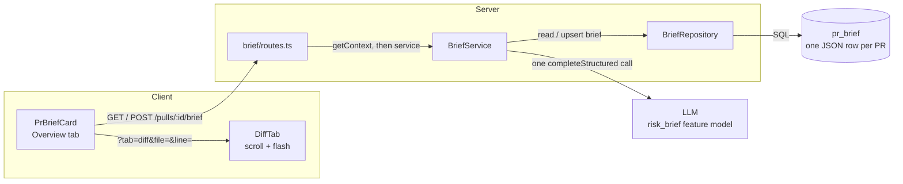
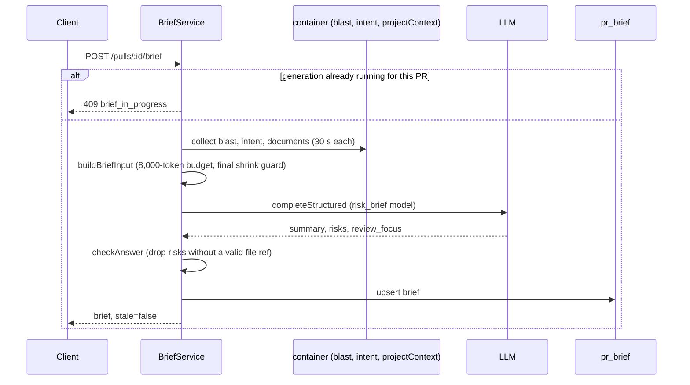

# PR Brief (L05)

> Type: explanation. As of `bd422a6` with uncommitted changes.
> Scope: [`specs/2026-11-07-pr-brief.md`](../../specs/2026-11-07-pr-brief.md).
> Contract: `PrBriefResponse` in `server/src/vendor/shared/contracts/brief.ts` (mirrored in `client/src/vendor/shared/contracts/brief.ts`).

The PR Brief is a card on the PR Overview tab: a short summary, up to 6 risks and up to 8 "review focus"
items, each pointing at a file and line in the Files changed tab.

## Containers

## Generation flow

## Behaviour

- **Read vs generate.** `GET` only reads the stored row and computes staleness; it never calls a model
  (`server/src/modules/brief/routes.ts:77`, `service.ts:89`). `POST` generates and is rate-limited to 10 per
  minute (`constants.ts:53`).
- **One model call.** `service.ts:154` resolves the `risk_brief` feature model; the call is a single
  `completeStructured` with schema `PrBriefAnswer` (`constants.ts:61`). Timeout per attempt 50 s, one repair
  retry (`constants.ts:36-38`).
- **Input budget.** The request holds at most 8,000 tokens including the system prompt
  (`constants.ts:9`). Each section has a cap (`constants.ts:14-19`); documents are fitted whole while they
  fit. If the assembled request is still over budget, a final guard first drops the listed missing-document
  paths, then re-cuts the largest capped section (`helpers.ts:572-600`).
- **Untrusted text.** PR, repo and model text goes into the prompt wrapped with fixed labels
  (`wrapUntrusted`, see the plan's S5; `helpers.ts:354` `buildBriefInput`).
- **Answer check.** A risk whose file refs are all invalid is dropped; focus items get their line checked
  against the PR's new-side ranges and caller lines (`helpers.ts:715`). Summary is capped at 600 chars
  (`constants.ts:27`).
- **Staleness.** A stored brief is stale with reason `new_commit` when its `head_sha` differs from the PR head
  and `new_review` when the newest review is not the one it was built from (`helpers.ts:768`).
  Review runs and finding actions invalidate the client query (`client/src/lib/hooks/reviews.ts:72,92,155`).
- **Concurrency and deadline.** One generation per PR: a second `POST` gets `409 brief_in_progress`
  (`service.ts:118`). The in-memory lock is per API instance. The whole generation has a 115 s deadline that
  answers `502 brief_generation_failed`; once the write has started the deadline no longer abandons the run
  (`service.ts:125-141`, `constants.ts:46`).
- **Storage.** `pr_brief` has `pr_id` (PK, cascade) and a `json` column (`server/src/db/schema/reviews.ts:91`).
  No migration was added for this feature.

## Client

- `PrBriefCard` (`client/src/app/repos/[repoId]/pulls/[number]/_components/PrBrief/`) uses `usePrBrief`
  (`client/src/lib/hooks/brief.ts`); strings live in `client/messages/en/brief.json`. Model text is rendered
  as React text only.
- A risk or focus link goes to `?tab=diff&file=<path>&line=<n>` (`diffFocusHref`,
  `.../DiffTab/helpers.ts:67`). `page.tsx` reads `file` / `line` and passes `focus` to `DiffTab`
  (`page.tsx:96-97`); switching tabs clears both params (`page.tsx:89-91`).
- `DiffTab` waits until layout and threads above the target have loaded, scrolls once per (focus, layout),
  and flashes the line for `FOCUS_FLASH_MS` = 2000 ms (`DiffTab.tsx:63-73`,
  `client/src/components/diff-viewer/constants.ts:7`).

## Related

- Tests: `server/test/brief-helpers.test.ts`, `server/test/brief.it.test.ts`,
  `server/test/project-context-forbrief.test.ts`; client `PrBriefCard.test.tsx`, `DiffTab.test.tsx`.
- Brief documents come from `ProjectContextFacade.forBrief` (`server/src/modules/project-context/`).
