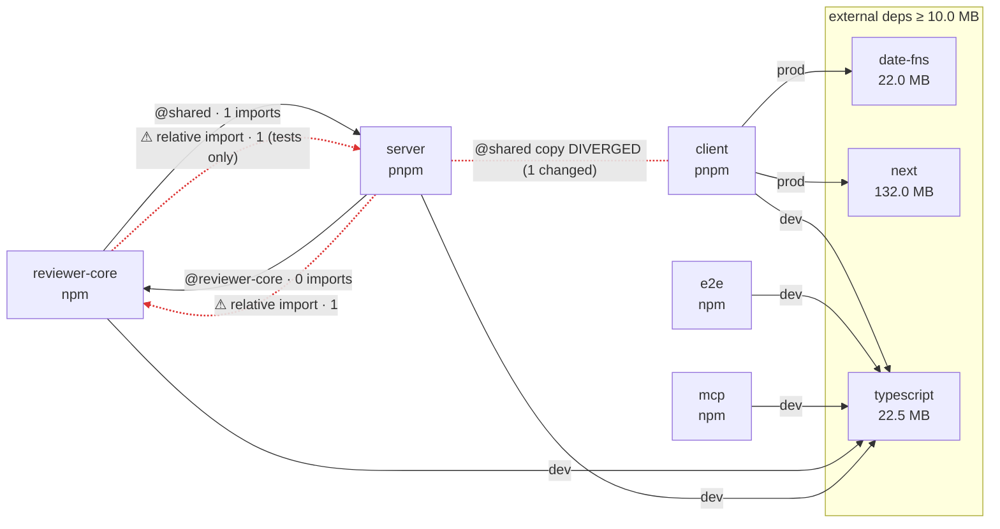

# Dependency facts — 2026-01-01 @ fixture

> Numbers below are measured, not estimated. Candidates are UNRANKED: assign P0–Info yourself.

## 1. Scope

Analyzed 5 packages · mode: offline · commit fixture · 2026-01-01

| package | manager | prod | dev | peer | node_modules (incl. transitive) |
|---|---|---:|---:|---:|---:|
| client | pnpm | 6 | 3 | 0 | 196.3 MB |
| e2e | npm | 0 | 2 | 0 | 25.7 MB |
| mcp | npm | 2 | 1 | 0 | 30.1 MB |
| reviewer-core | npm | 1 | 2 | 0 | 25.1 MB |
| server | pnpm | 5 | 3 | 0 | 49.3 MB |

## 2. Dependency graph (draft — edit freely, keep edge facts)

## 3. Size breakdown

### client — pnpm, direct deps own size 196.3 MB, node_modules 196.3 MB

| dependency | type | declared → resolved | size | % of direct | usage | flags |
|---|---|---|---:|---:|---|---|
| next | prod | 15.0.3 → 15.0.3 | 132.0 MB | 67.2% | prod | — |
| typescript | dev | 5.6.3 → 5.6.3 | 22.5 MB | 11.5% | tooling | — |
| date-fns | prod | 4.1.0 → 4.1.0 | 22.0 MB | 11.2% | prod | — |
| react-dom | prod | 19.0.0 → 19.0.0 | 6.9 MB | 3.5% | framework-implicit | — |
| tailwindcss | dev | 3.4.14 → 3.4.14 | 5.0 MB | 2.5% | tooling | — |
| @tanstack/react-query | prod | 5.59.0 → 5.59.0 | 4.1 MB | 2.1% | prod | — |
| zod | prod | 3.22.4 → 3.22.4 | 1.9 MB | 1.0% | prod | — |
| vitest | dev | 2.1.4 → 2.1.4 | 1.6 MB | 0.8% | tooling | — |
| react | prod | 19.0.0 → 19.0.0 | 307.2 KB | 0.2% | framework-implicit | — |

### e2e — npm, direct deps own size 25.7 MB, node_modules 25.7 MB

| dependency | type | declared → resolved | size | % of direct | usage | flags |
|---|---|---|---:|---:|---|---|
| typescript | dev | 5.6.3 → 5.6.3 | 22.5 MB | 87.5% | none | unused-dev |
| playwright | dev | 1.48.2 → 1.48.2 | 3.2 MB | 12.5% | prod | — |

### mcp — npm, direct deps own size 30.1 MB, node_modules 30.1 MB

| dependency | type | declared → resolved | size | % of direct | usage | flags |
|---|---|---|---:|---:|---|---|
| typescript | dev | 5.6.3 → 5.6.3 | 22.5 MB | 74.8% | tooling | — |
| @modelcontextprotocol/sdk | prod | 1.0.0 → 1.0.0 | 4.0 MB | 13.3% | prod | — |
| zod | prod | 4.1.0 → 4.1.0 | 3.6 MB | 12.0% | prod | — |

### reviewer-core — npm, direct deps own size 25.1 MB, node_modules 25.1 MB

| dependency | type | declared → resolved | size | % of direct | usage | flags |
|---|---|---|---:|---:|---|---|
| typescript | dev | 5.6.3 → 5.6.3 | 22.5 MB | 89.6% | tooling | — |
| zod | prod | 3.23.8 → 3.23.8 | 2.1 MB | 8.4% | prod | — |
| tsx | dev | 4.19.0 → 4.19.0 | 512.1 KB | 2.0% | none | unused-dev |

### server — pnpm, direct deps own size 49.3 MB, node_modules 49.3 MB

| dependency | type | declared → resolved | size | % of direct | usage | flags |
|---|---|---|---:|---:|---|---|
| typescript | dev | 5.6.3 → 5.6.3 | 22.5 MB | 45.6% | tooling | — |
| drizzle-orm | prod | 0.36.0 → 0.36.0 | 8.1 MB | 16.4% | prod | — |
| fastify | prod | 5.1.0 → 5.1.0 | 6.5 MB | 13.2% | prod | — |
| moment | prod | 2.30.1 → 2.30.1 | 4.2 MB | 8.5% | none | unused |
| pg | prod | 8.13.0 → 8.13.0 | 3.8 MB | 7.7% | prod | — |
| zod | prod | 3.23.8 → 3.23.8 | 2.1 MB | 4.3% | prod | — |
| vitest | dev | 2.1.4 → 2.1.4 | 1.6 MB | 3.2% | tests-only | — |
| tsx | dev | 4.19.0 → 4.19.0 | 512.1 KB | 1.0% | tooling | — |

### Top 10 across the repo (own size, per package)

| # | package | dependency | type | size |
|--:|---|---|---|---:|
| 1 | client | next | prod | 132.0 MB |
| 2 | client | typescript | dev | 22.5 MB |
| 3 | e2e | typescript | dev | 22.5 MB |
| 4 | mcp | typescript | dev | 22.5 MB |
| 5 | reviewer-core | typescript | dev | 22.5 MB |
| 6 | server | typescript | dev | 22.5 MB |
| 7 | client | date-fns | prod | 22.0 MB |
| 8 | server | drizzle-orm | prod | 8.1 MB |
| 9 | client | react-dom | prod | 6.9 MB |
| 10 | server | fastify | prod | 6.5 MB |

## 4. Finding candidates (raw, unranked)

- [bypass] reviewer-core → server: 1 relative import(s) around the alias, tests only — test/pipeline.test.ts:1 → ../../server/src/adapters/mocks.js
- [bypass] server → reviewer-core: 1 relative import(s) around the alias, 1 in production code — src/services/review-service.ts:4 → ../../../reviewer-core/src/pipeline.js
- [copy-diverged] alias @shared: client/src/vendor/shared (1 files) vs server/src/vendor/shared (1 files) — 1 changed: review-types.ts; only in one copy: {}
- [drift-linked] zod: client 3.22.4 (prod, pnpm), reviewer-core 3.23.8 (prod, npm), server 3.23.8 (prod, pnpm) — these packages import each other or share a copied module, so they exchange zod values → propose (align to 3.23.8): cd client && pnpm add zod@3.23.8
- [drift-isolated] zod: mcp 4.1.0 (prod, npm) vs 3.22.4 / 3.23.8 in the linked packages — mcp shares no imports or copied modules with them, so this version does not have to match
- [unused-dev] e2e/typescript (dev, npm, 22.5 MB, usage none) → propose: cd e2e && npm uninstall typescript
- [unused-dev] reviewer-core/tsx (dev, npm, 512.1 KB, usage none) → propose: cd reviewer-core && npm uninstall tsx
- [unused] server/moment (prod, pnpm, 4.2 MB, usage none) → propose: cd server && pnpm remove moment
- [dup-dev-tool] typescript (dev) in 5 packages (client, e2e, mcp, reviewer-core, server): ~22.5 MB each — expected cost of independent packages, never a reason to propose a workspace
- [heavy] client/next (prod): 132.0 MB
- [heavy] client/date-fns (prod): 22.0 MB

## 5. Limits of these facts

- Size = the dependency's own files on its real path; transitive dependencies are not added to it.
- `unused` is by static import scan + package.json scripts + config files; dynamic `require(variable)` and framework conventions can hide a real use — verify before removing.
- `tests-only` / `tooling` mean no import from production code was found.
- Offline run: no `outdated` / `audit` data. Re-run with `--online` for those.
