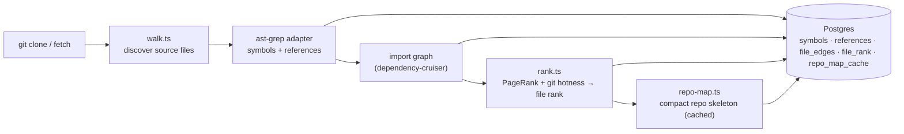

# `repo-intel` — the codebase indexer

`repo-intel` reads a cloned repository **once on clone** (and incrementally on
fetch, keyed by file content hash) and turns it into queryable facts: symbols,
the import graph, a PageRank-based file importance score, and a compact **repo
map** (the project skeleton). On a review it is only **read** — the index is
already computed, so adding context to a prompt costs no analysis at request time.

This is **starter infrastructure**: it works from day 1 (the **Indexed** badge),
but you don't write it. Course lessons build features _on top_ of its facade —
Blast Radius (L05), Conventions samples (L02), Onboarding reading-path (L05),
the Phantom-API gate (L06) — by calling `repoIntel.*`, not by re-indexing.

## Pipeline

Full vs incremental indexing lives in `pipeline/{full,incremental}.ts`; an
unindexed or partially-indexed repo degrades gracefully (the facade returns empty
results rather than throwing).

## Facade (`repoIntel.*`)

Everything downstream reads through one facade (`service.ts`) so consumers never
touch the pipeline internals:

- `getRepoMap(repoId)` → the cached repo skeleton (fed into the **review prompt**).
- `getFileRank(repoId, files)` → importance percentile per changed file.
- `getCallerSignatures(repoId, files, limit)` → callers of changed symbols.
- `getBlastRadius(repoId, files)` → changed symbols, callers, impacted endpoints and
  `factsByFile` (used by `GET /pulls/:id/blast`, see below).
- `getUnresolvedReferences(repoId, …)` → phantom-symbol detection (used by L06).
- `getConventionSamples(repoId)` → top-ranked files for convention extraction (L02).

`getRepoMap` / `getFileRank` / `getCallerSignatures` are wired into
`modules/reviews/run-executor.ts`, which adds the repo map and a
high-blast-radius note to the prompt. Toggled by `REPO_INTEL_ENABLED` (global)
and a per-agent `repo_intel` flag. `getBlastRadius` is read by `modules/blast`.

### `getBlastRadius` behaviour

As of `c1154a9` (with uncommitted changes).

- **Persistent path** (`tryPersistentBlast`, `service.ts:316`): used when
  `REPO_INTEL_ENABLED` is on, files were passed, and the index status is `full` or
  `partial`. Only references whose `decl_file` resolved to a changed file count as
  callers (precision over recall). Result has `degraded: false`.
- **Fallback**: otherwise a ripgrep/ast-grep scan of the clone. It always returns
  `degraded: true, reason: 'no_data'` and `rank: 0` callers (`service.ts:221-305`).
- **Caller cap is per changed symbol**: at most `MAX_CALLERS_PER_SYMBOL` (20,
  `constants.ts:30`) callers per `viaSymbol`, rank-sorted, via `capCallersPerSymbol`
  (`helpers.ts`) — one hot symbol cannot hide the others.
- **Endpoints / crons** (`factsByFile`): each caller file's facts are its own plus
  those of its importers, walked up to `BFS_DEPTH` hops (2, `constants.ts:49`; the
  direct caller is hop 1) over `file_edges` (`advanceFrontier`, `rollUpFacts`).
  Test files (`isTestPath`: `*.test.*`, `*.spec.*`, or a `test`/`tests`/`__tests__`/
  `__mocks__`/`e2e` directory) are excluded from facts.
- The facade itself only ever reports `no_data`; the honest degradation reason
  (`index_partial`, `flag_off`, `index_failed`, …) is derived by `modules/blast`.

## Routes

- `GET /repos/:id/index-state` — index status (drives the **Indexed** badge).
- `POST /repos/:id/resync` — enqueue a re-index.
