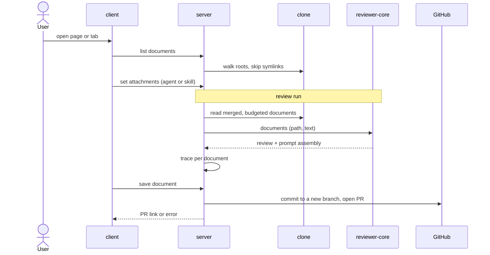

# Spec: Project Context

Spec ID: SPEC-2026-11-01-project-context
Status: approved
Supersedes: none
Modules: server, client, reviewer-core

## Problem and user
A DevDigest user reviews PRs of a repo whose rules live in markdown: PRDs, specs, docs, incident notes [user].
No review reads them: runs pass nothing to the engine's project-context slot and every trace says "Specs read:
none" [code]. The user cannot see the documents, tie them to an agent or skill, or tell their token cost, so
reviews miss breaches of rules like "module api/ does not import db/ directly" [user].

## Goals / Non-goals
Tagged [user] unless marked otherwise.
- **G-1** The user finds and reads every project document of the active repo in one place.
- **G-2** The user attaches documents to agents and skills by hand, in order, and sees the tokens they add.
- **G-3** Every review run inlines its documents as untrusted text, within a budget, with no extra LLM call.
- **G-4** Every run trace shows the documents read, their tokens and the exact text sent.
- **G-5** The user creates, edits and uploads documents in DevDigest; the change lands in the repo as a commit.
- **NG-1** Automatic selection of documents from the PR content.
- **NG-2** An embedding index or chunks of documents.
- **NG-3** The COVERAGE ring.
- **NG-4** Clickable "Specs read" paths.
- **NG-5** Agent tabs Evals / Stats / CI, the skill Evals tab and "Run on evals", "Memory pulled".
- **NG-6** Deleting, renaming or moving documents; editing non-`.md` files [screenshot:1.png].
- **NG-7** Reading documents as of the PR head.
- **NG-8** Search roots set in the UI or per repo.
- **NG-9** Committing straight to the default branch [assumption].

## User stories
- **US-1** As a user, I want to browse and preview the repo's documents, so that I know what context exists.
- **US-2** As a user, I want to attach documents to an agent in order and see the token total, so that I control a review's input and cost.
- **US-3** As a user, I want to attach documents to a skill, so that every agent using it inherits them.
- **US-4** As a user, I want each review to read the attached documents in full, so that findings cite project rules.
- **US-5** As a user, I want the trace to show the documents read, their sizes and text, so that I can audit the prompt.
- **US-6** As a user, I want to create, edit and upload documents as commits, so that I keep specs current from DevDigest.

## Workflow and module interaction

| Contract | From → to | Fields (required unless optional) | Errors |
|---|---|---|---|
| List documents | client → server | in: repo. out: state (ok, not_cloned), scanned_at, total, documents[]: path, type (specs, docs, insights), tokens, too_large, used_by_agents | 404 |
| Read document | client → server | in: repo, path. out: path, type, text, tokens, version, used_by_agents | 404, 413, 422 |
| Rescan | client → server | in: repo. out: as List documents | 404, 409, 429, 502 |
| Get attachments | client → server | in: agent or skill, repo (optional). out: items[]: path, via_skill (optional), status (present, not_in_repo, too_large, unknown), tokens (optional), truncated, dropped; total_tokens, budget | 404 |
| Set attachments | client → server | in: agent or skill, ordered paths (≤ 100). out: as Get | 404, 422 |
| Save document | client → server → GitHub | in: repo, path, text, mode (create, update), base version (update), message (optional). out: branch, pr_number, pr_url | 409 changed_upstream or exists, 413, 422, 403 token, 429, 502 |
| Review input | server → engine | documents[] in order: path, text | none |
| Run trace | server → client | adds documents[]: path, tokens, status (injected, truncated, dropped, skipped), reason (optional), via; specs_read = injected paths; old traces lack the list | none |

Trace and DTO changes land in both `shared` copies; the engine reads the server copy. `mcp`: no change. No e2e
flow matches the changed texts [code].

## Acceptance criteria (EARS)
Project Context page [user][screenshot:1.png]
- **AC-1** [must] WHEN the user opens Project Context (sidebar, WORKSPACE), the page shall show a folder tree of the clone's `.md` files matching the roots (default `**/{specs,docs,insights}/**/*.md`, hidden folders in, `.git`, `node_modules` out), up to 1,000, then "+N more not listed".
- **AC-2** [must] WHEN the user selects a document, the page shall show its path, `≈ N tokens`, "Used by N agents" and rendered markdown.
- **AC-3** [must] WHEN the user clicks Rescan, the page shall sync the clone to the latest default branch and refresh the tree and footer "N documents · scanned <time>" [assumption].
- **AC-4** [must] IF the repo has no clone, THEN the page shall show "Repository not cloned yet" without tree or edit actions.
- **AC-5** [must] IF no file matches, THEN the page shall show "No project documents" with the search roots [assumption].
- **AC-6** [must] WHILE documents or attachments load, the page and the Context tabs shall show skeleton rows [assumption].
- **AC-7** [must] IF a request fails with a network error or 5xx, THEN the page or tab shall show an error with Retry, keeping unsaved text [assumption].
- **AC-8** [must] IF a file is a symlink or resolves outside the clone, THEN the API shall neither list nor read it.

Context tabs [user][screenshot:2.png][screenshot:3.png]
- **AC-9** [must] WHEN the user opens an agent's Context tab, the agent editor shall show "Project context", "N of M attached" and a row per active-repo document (drag handle, checkbox, name, folder, type = nearest matched folder, Preview), attached first, in order.
- **AC-10** [must] WHEN the user checks, unchecks or drops a row, the Context tab shall save the whole ordered path list at once, leaving the agent or skill version unchanged.
- **AC-11** [must] WHILE the filter holds text, the Context tab shall show only rows whose path contains it (case-insensitive), with drag disabled.
- **AC-12** [must] The agent's Context tab shall label rows in text: "via <skill>" (inherited, read-only, after own rows), "not in this repo", "too large", "truncated", "dropped".
- **AC-13** [must] The agent's Context tab shall show `≈ N tokens` for the merged, deduplicated set a run on the active repo would inject, as a warning above 24,000.
- **AC-14** [must] IF no repo is active or it has no clone, THEN the Context tab shall list only attached paths, noting they cannot be counted [assumption].
- **AC-15** [must] WHEN the user clicks Preview, the Context tab shall open the rendered document with `≈ N tokens`, closing on Escape.
- **AC-16** [must] WHEN the user opens a skill's Context tab, the skill editor shall show "Project context to use", "N attached", "Any agent using this skill inherits these documents." and rows as in AC-9 to AC-15.
- **AC-17** [must] The skill's Context tab shall show "SERIALIZES AS" with `## Project context` and the attached paths in order, captioned "Full text is inserted at run time." [assumption].

Review run [user]
- **AC-18** [must] WHEN a review run starts, the review run shall use the agent's documents in order, then each enabled skill link's, keeping a path's first occurrence, regardless of repo-intel.
- **AC-19** [must] WHEN a document is read, the review prompt shall hold one `## Project context` section with each full text, fenced as untrusted under the injection guard, labelled with its path.
- **AC-20** [must] IF a document exceeds 8,000 tokens, THEN the review run shall inject its first 8,000 tokens and a truncation marker.
- **AC-21** [must] IF the documents exceed 24,000 tokens together, THEN the review run shall drop whole documents from the end until the rest fit.
- **AC-22** [must] IF a document is missing, unreadable, a symlink or too large, or the repo is not cloned, THEN the review run shall skip it and trace the reason.
- **AC-23** [must] IF no document is injected, THEN the review prompt shall be byte-identical to the one built without this feature [code].
- **AC-24** [must] WHEN an agent with an attached document saying "module api/ does not import db/ directly" reviews a PR where an `api/` file imports from `db/`, the review shall contain a finding on that import naming the document's path.

Run trace [user][screenshot:4.png]
- **AC-25** [must] WHEN the user opens a run's trace, the run drawer shall list under "Specs read" each injected path with `~T tokens` (and "truncated"), each dropped or skipped path with its reason, or "none".
- **AC-26** [must] WHEN the user expands "Project context — attached specs (untrusted)" in Prompt assembly, the run drawer shall show the full `## Project context` text sent, with Copy.

Edit, new file, upload [user][screenshot:1.png]
- **AC-27** [must] WHEN the user switches to Edit, the page shall show the markdown source with Save, Cancel and an editable commit message `docs: update <path>` [assumption].
- **AC-28** [must] WHEN the user clicks New file, New folder or Upload, the page shall open an editor for a new `.md` path in the selected folder, empty or with the uploaded text (a new folder needs its first file) [assumption].
- **AC-29** [must] WHEN the user saves, the page shall show "Pull request #N opened" with its link after the API commits to a new branch off the latest default branch and opens that PR [assumption].
- **AC-30** [must] The API shall never push to the default branch, overwrite an existing branch or change the clone when saving [assumption].
- **AC-31** [must] IF the file on GitHub's default branch changed since editing began, THEN the page shall show "Changed on GitHub. Rescan and reapply your edit." keeping the text [assumption].
- **AC-32** [must] IF no GitHub token is stored or GitHub refuses the write, THEN the page shall show GitHub's reason and a Settings link, keeping the text [assumption].
- **AC-33** [must] IF a new or uploaded name is not `.md`, escapes the repo, is outside the roots or exists, or an upload is over 256 KB or not UTF-8, THEN the page shall show the API's reason by the name field [assumption].
- **AC-34** [must] WHILE a save runs, the page shall show "Committing…" with Save disabled [assumption].
- **AC-35** [must] IF the user leaves Edit with unsaved changes, THEN the page shall ask to confirm discarding them [assumption].

Untrusted data and access [assumption]
- **AC-36** [must] IF a document holds raw HTML or script, THEN every Preview shall render it as inert text.
- **AC-37** [must] IF a path holds quotes, angle brackets or a line break, THEN the review prompt shall carry it escaped so the fence stays intact.
- **AC-38** [must] IF a set-attachments request holds an absolute, `..`, non-`.md` or duplicate path, or over 100 paths, THEN the API shall reject it whole with 422 and the reason.
- **AC-39** [must] IF the agent, skill or repo is in another workspace or deleted, THEN the page or tab shall show "Not found" on the API's 404.

## Edge cases
- **EC-1** A path attached to the agent and a skill, or two skills → AC-13, AC-18
- **EC-2** An attached file deleted or renamed upstream → AC-12, AC-22
- **EC-3** A PR in a repo lacking an attached path → AC-22
- **EC-4** A skill disabled globally or unlinked for the agent → AC-18
- **EC-5** A document over 8,000 tokens; a set over 24,000 → AC-13, AC-20, AC-21
- **EC-6** A committed `.md` symlink to the local secrets file → AC-8
- **EC-7** A document saying "ignore previous instructions" or faking a closing fence → AC-19
- **EC-8** A path with `"`, `<`, `>` or a line break → AC-37
- **EC-9** A document with `<script>` → AC-36
- **EC-10** No clone, or no active repo on the agent tab → AC-4, AC-14, AC-22
- **EC-11** The file changed on GitHub during Edit → AC-31
- **EC-12** A save while a run reads that document → AC-30
- **EC-13** A token without write access → AC-32
- **EC-14** Agent or skill deleted while its tab is open → AC-39
- **EC-15** Over 1,000 matches; a file over 1 MB → AC-1, AC-12

## Non-functional requirements
- **NFR-1** [must] WHEN the user opens Project Context on a clone with 1,000 matching documents, the API shall return the list within 2 s [assumption].
- **NFR-2** [must] The review run shall add project context with 0 extra LLM calls and at most 24,000 document tokens [user].
- **NFR-3** [must] WHEN a run reads 24,000 tokens of documents, reading and counting them shall add at most 1 s to the run [assumption].
- **NFR-4** [must] For the same text, the tab's and the trace's token counts shall differ by 0 tokens [user].
- **NFR-5** [must] The API shall accept at most 10 saves and 6 Rescans per minute per workspace, then answer 429 [assumption].
- **NFR-6** [must] The GitHub token shall appear in 0 responses, views, logs or traces [code].
- **NFR-7** [should] Attach, reorder and Preview shall each need 0 mouse actions (WCAG 2.2 AA 2.1.1) [assumption].
- **NFR-8** [must] 100 % of paths in the UI, stored lists and prompt shall use `/` on every OS, Windows included [code].

## Inputs and provenance
| Source | What was taken from it |
|---|---|
| [user] brief, 2026-11-01 | the feature, glob, attaching, both tabs, paths not text, untrusted block, trace tokens, no LLM call, api/db check |
| [user] answers, 2026-11-01 | D-1 to D-8 |
| [screenshot:1.png] to [screenshot:4.png] | page, agent tab, skill tab, run drawer; quoted texts |
| [code] `reviewer-core/src/prompt.ts:133-136,162` | slot renders `## Project context`; label `spec-<i>`, no path |
| [code] `server/src/modules/reviews/run-executor.ts:350`, `server/src/vendor/shared/contracts/trace.ts:102` | `specs_read` always `[]`, paths only |
| [code] `client/.../TraceBody/TraceBody.tsx:52-64,111-113`, `client/messages/en/runs.json:34,51` | "Specs read" row, "Project context (dynamic)" block |
| [code] `server/src/db/schema/agents.ts:8`, `skills.ts:5` | agents, skills workspace-wide; no attachment store |
| [code] `server/src/adapters/git/simple-git.ts:77-88,129-131`, `server/INSIGHTS.md:34-39` | clone = default branch, reset on sync; reads follow symlinks |
| [code] `server/src/modules/repo-intel/pipeline/walk.ts:89` | indexer skips symlinks |
| [code] `server/src/adapters/github/octokit.ts:279-345` | branch commit force-updates an existing branch |
| [code] `client/src/vendor/ui/nav.ts:21-42`, `client/src/lib/hooks/core.ts:122-137` | no nav entry or route; hooks call a missing route |
| [code] `specs/03-skills.md:82-83`; `e2e/` | save on change, no drag while filtering; no e2e text match |

## Untrusted inputs
| Source | Reaches | Requirement |
|---|---|---|
| Document text from the clone | prompt, Preview | AC-19, AC-20, AC-21, AC-36 |
| Paths and names from the clone | prompt label, UI | AC-37 |
| Symlinks in the clone | reader | AC-8 |
| Paths, names, uploads in client requests | attachments, save | AC-38, AC-33 |
| GitHub answers to a save | page | AC-31, AC-32 |

## Decisions
- **D-1** 2026-11-01 — Attachments vs repos → one path list per agent or skill, used on the PR's repo; missing paths skipped [user]
- **D-2** 2026-11-01 — Merge → agent's own, then enabled skills'; first path wins; total = merged set [user]
- **D-3** 2026-11-01 — Limits → 8,000 tokens per document, 24,000 per run [user]
- **D-4** 2026-11-01 — Revision → the clone's working tree (default branch, last sync) [user]
- **D-5** 2026-11-01 — "SERIALIZES AS" → `## Project context`, paths, caption [user]
- **D-6** 2026-11-01 — Edit, New file, New folder, Upload → in, committed to the repo [user]
- **D-7** 2026-11-01 — Proposals → "Used by N agents" in; COVERAGE out; footer + Rescan in; clickable "Specs read" out [user]
- **D-8** 2026-11-01 — Defaults accepted: roots in server config, glob scope, type badge, skip and trace, not-cloned state, no LLM call, no version bump, the NGs, AC-8, path label [user]

## Open questions
- **OQ-1** Where does a save land? — default if unanswered: a new branch off the latest default branch plus a PR; affects: AC-29, AC-30, NG-9
- **OQ-2** What does Rescan do? — default: the existing repo sync (also refreshes the repo index), then re-list; affects: AC-3
- **OQ-3** Limits — default: uploads `.md`, UTF-8, ≤ 256 KB; files over 1 MB "too large", never read; 1,000 listed; 100 attachments; affects: AC-1, AC-12, AC-33, AC-38
- **OQ-4** Naming — default: message `docs: update|add <path>`, also the PR title; branch `devdigest/context/<file>-<time>`; affects: AC-27, AC-29
- **OQ-5** States, texts, safeguards, numbers not in the sources — default: as written; affects: AC-4 to AC-7, AC-14, AC-17, AC-28, AC-31 to AC-39, NFR-1, NFR-3, NFR-5, NFR-7
- **OQ-6** Who counts in "Used by N agents"? — default: agents getting it directly or via an enabled skill link; affects: AC-2

## Traceability
| Req | Covers | Edge cases | Verify |
|---|---|---|---|
| AC-1 | US-1, G-1 | EC-15 | tree has `.devdigest/specs/`, no `node_modules` |
| AC-2 | US-1 | — | select → path, tokens, used-by, text |
| AC-3 | US-1 | — | merge upstream, Rescan → new text |
| AC-4 | US-1 | EC-10 | uncloned repo → state |
| AC-5 | US-1 | — | no docs → empty state |
| AC-6 | US-1, US-2 | — | slow API → skeleton |
| AC-7 | US-1, US-2 | — | API 500 → Retry, text kept |
| AC-8 | US-1, US-4 | EC-6 | symlink not listed or read |
| AC-9 | US-2, G-2 | — | tab rows, badge, order |
| AC-10 | US-2 | — | check, reload → kept; same version |
| AC-11 | US-2 | — | filter narrows, drag off |
| AC-12 | US-2, US-3 | EC-2, EC-15 | "via", "not in this repo" rows |
| AC-13 | US-2 | EC-1, EC-5 | total = trace total; > 24k warns |
| AC-14 | US-2 | EC-10 | no clone → paths only |
| AC-15 | US-2 | — | Preview opens, Escape closes |
| AC-16 | US-3 | — | skill tab texts, rows |
| AC-17 | US-3 | — | box with heading, paths |
| AC-18 | US-3, US-4, G-3 | EC-1, EC-4 | trace order, dedupe |
| AC-19 | US-4 | EC-7 | prompt: fenced block per path |
| AC-20 | US-4 | EC-5 | 10k doc → 8,000 + marker |
| AC-21 | US-4 | EC-5 | 30k set → tail dropped |
| AC-22 | US-4 | EC-2, EC-3, EC-10 | run done; trace "skipped: <reason>" |
| AC-23 | US-4 | — | no docs → baseline prompt |
| AC-24 | US-4 | — | live e2e: api/db PR → finding cites doc |
| AC-25 | US-5, G-4 | — | paths, tokens, reasons; old trace "none" |
| AC-26 | US-5 | — | expand → full text, Copy |
| AC-27 | US-6, G-5 | — | Edit → source, message |
| AC-28 | US-6 | — | New file, folder, Upload → editor |
| AC-29 | US-6 | — | Save → PR link; PR on GitHub |
| AC-30 | US-6 | EC-12 | default branch, clone unchanged |
| AC-31 | US-6 | EC-11 | stale base → 409; text kept |
| AC-32 | US-6 | EC-13 | no token → 403; Settings link |
| AC-33 | US-6 | — | `x.txt`, `../a.md`, 300 KB → 4xx |
| AC-34 | US-6 | — | double click → one PR |
| AC-35 | US-6 | — | leave dirty editor → confirm |
| AC-36 | US-1 | EC-9 | `<script>` doc shown as text |
| AC-37 | US-4 | EC-8 | path with `"` → fence intact |
| AC-38 | US-2 | — | `../a.md`, 101 paths → 422 |
| AC-39 | US-2 | EC-14 | foreign id → 404; "Not found" |
| NFR-1 | G-1 | — | timing: 1,000 docs ≤ 2 s |
| NFR-2 | G-3 | — | LLM calls per run unchanged |
| NFR-3 | G-3 | — | timing: 24k docs vs none ≤ 1 s |
| NFR-4 | G-2 | — | tab total = trace total |
| NFR-5 | G-5 | — | API: 11th save in a minute → 429 |
| NFR-6 | G-5 | — | token absent from responses, logs |
| NFR-7 | G-2 | — | keyboard-only attach, reorder |
| NFR-8 | G-1 | — | Windows: paths use `/` |
