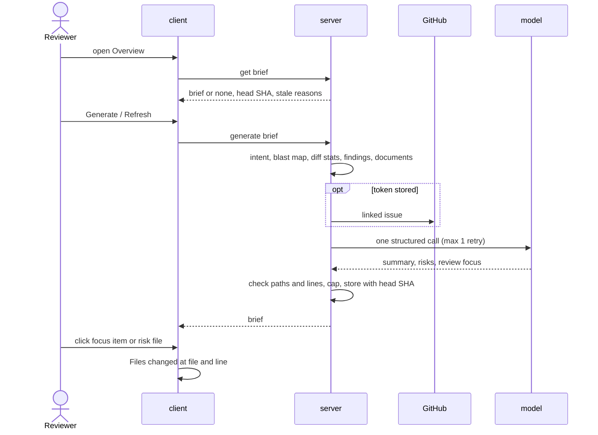

# Spec: PR Brief

Spec ID: SPEC-2026-11-07-pr-brief
Status: approved
Supersedes: none
Modules: server, client

## Problem and user
A reviewer often opens someone else's PR cold: why does it exist, what is risky, where to start [user]? Intent, Smart
Diff roles, Blast radius and review findings each answer a part on separate cards and tabs; nothing joins them or says
which lines to read first [user][code]. A brief store and shape exist, unused [code].

## Goals / Non-goals
Tagged [user] unless marked otherwise.
- **G-1** One PR Brief on Overview: summary, Risk areas, Review focus, beside Intent and Blast radius.
- **G-2** One model call writes it from computed facts, within 8,000 tokens, never reading diff code.
- **G-3** Every file it names is in the PR or the blast map; every focus line is a changed line.
- **G-4** A focus or risk click lands on that file and line in Files changed.
- **G-5** It survives reloads without a model call, shows staleness, regenerates on request.
- **NG-1** "Prior PRs touching these files"; history stays empty [screenshot:1.png].
- **NG-2** Deriving intent or recomputing the blast map while generating.
- **NG-3** Auto-regeneration on a new commit or review [assumption].
- **NG-4** An MCP tool or e2e flow for the brief [assumption].
- **NG-5** Process deliverables (commits, PR video, cross-model note, verifier report, retro, cost report).
- **NG-6** Following a generation across a reload [assumption].
- **NG-7** Choosing documents per PR (D-1).

## User stories
- **US-1** As a reviewer, I want a Generate brief button, so that I choose when to pay for a model call.
- **US-2** As a reviewer, I want a summary of what the PR does and why, so that I start with context.
- **US-3** As a reviewer, I want risks with severity and file, so that I know what can break.
- **US-4** As a reviewer, I want ordered `file:line — reason` items that open the line, so that I start right.
- **US-5** As a reviewer, I want the brief to name missing data, so that I know how far to trust it.
- **US-6** As a reviewer, I want the brief kept, flagged when stale, regenerable, so that I neither pay twice nor misread.
- **US-7** As a workspace owner, I want the Settings model, a fixed budget and one logged call, so that I control cost.
- **US-8** As a reviewer, I want the latest verdict and score above the summary, so that I see the review outcome.

## Workflow and module interaction

| Contract | From → to | Fields (required unless opt.) | Errors |
|---|---|---|---|
| Get brief | client → server | in: PR id. out: brief (opt.), pr_head_sha, stale, stale_reasons[] (new_commit, new_review) | 404, 422 |
| Generate brief | client → server | in: PR id. out: as Get brief | 404, 409 brief_in_progress, 422, 429, config_error, 502 |
| Brief (both `shared` copies) | server → client | summary; risks[]: kind, title, explanation, severity (high, medium, low), file_refs[] (`path` or `path:start[-end]`); review_focus[]: file, line (int ≥ 1), reason; intent, blast, review_id, cost_usd (opt.); history (empty); head_sha; generated_at; provider; model; tokens_in, tokens_out; attempts; inputs[]: source, ref (opt.), status (used, truncated, missing), tokens, reason (opt.) | none |
| Model answer | model → server | summary, risks[], review_focus[] | invalid → 1 retry, then 502 |

summary and review_focus are [user]; other fields [assumption] (OQ-9). The engine reads the server `shared` copy; mcp
shapes: no change. e2e flows match only "Files changed" and `tab=diff`, both unchanged [code].

**Model input** — one request, in this order; caps in tokens (D-1, D-2, D-4, D-6; reasons OQ-2)

| Input | Taken from | Cap | Reason when missing |
|---|---|---|---|
| System prompt | DevDigest | 700 | — |
| Diff stats + roles | per file: path, +/-, role, new-side hunk ranges (numbers) | 1,500 | never; tail files cut, "+N files" |
| Blast radius | map summary + caller `file:line` | 1,000 | "index incomplete: <reason>", "no callers" |
| Intent | stored: summary, scope, risk areas, confidence; stale one labelled (OQ-7) | 800 | "not derived yet" |
| Title + description | stored PR | 1,200 | "description empty" |
| Linked issue | description's first `#N`, same repo, from GitHub [code] | 800 | "none linked", "GitHub unavailable" |
| Review findings | newest review's open ones: severity, title, `file:line` | 1,000 | "no review yet" |
| Documents | D-1 | rest | "none attached", "repo not cloned" |

## Acceptance criteria (EARS)
"The card" = the PR Brief card.

Overview [user][screenshot:1.png]
- **AC-1** [must] WHEN the user opens Overview of a PR with no stored brief, the PR page shall show a "PR Brief" card with "Generate brief" above Intent and Blast radius.
- **AC-2** [must] WHEN a generation succeeds, the Overview tab shall show the summary, then Intent and Blast radius side by side (Risk areas under Intent), then Review focus.
- **AC-3** [must] WHILE the brief loads or generates, the card shall show skeleton rows with Generate and Refresh disabled (D-5).
- **AC-4** [must] WHEN the user reloads a PR page with a stored brief, the Overview tab shall show it without a model call.
- **AC-5** [must] WHEN the user clicks Refresh ("Regenerate brief"), the card shall replace the brief with a new one.
- **AC-6** [must] IF the PR head moved or a newer review finished since generation, THEN the card shall show "Stale" with "Generated for <sha7>, PR is at <sha7>" or "A newer review exists" (D-7).
- **AC-7** [must] The card shall show "Generated from <sha7> · <model> · $<cost> · <in>→<out> tokens", "—" for an unknown cost (D-6).
- **AC-8** [must] WHERE the PR has a review, the card shall show its newest verdict, "N findings · M blockers" and PR score above the summary (D-5).
- **AC-9** [must] IF an input was missing, THEN the card shall show "Generated without: <input> (<reason>)" for each.

Risk areas [user][screenshot:1.png]
- **AC-10** [must] The card shall list each risk's title, severity as icon colour plus text, and file references as `path` or `path:start-end`.
- **AC-11** [must] WHEN the user expands a risk, the card shall show its explanation (D-5).
- **AC-12** [must] WHEN the user clicks a risk's file reference, the PR page shall open Files changed at it as in AC-16 (D-5).
- **AC-13** [must] IF the brief has no risks, THEN the card shall show "No notable risks flagged." [code].
- **AC-14** [must] WHILE Overview shows a brief, the Intent card there shall omit its Risk areas chip row (D-6).

Review focus [user][screenshot:1.png]
- **AC-15** [must] The card shall show "Review focus — read these first", a count badge and `file:line — reason` rows in the model's order.
- **AC-16** [must] WHEN the user clicks a focus item, the PR page shall open `?tab=diff&file=<path>&line=<n>` as a new history entry, the file's group and card expanded and in view.
- **AC-17** [should] WHEN Files changed opens with a file and line, the diff shall scroll to and highlight the line for 2 s, without animation under reduced motion (D-6).
- **AC-18** [must] IF the URL's file is not in the PR's diff, THEN Files changed shall show "File not in this PR's diff" with the path (D-5).
- **AC-19** [must] WHEN the user presses Back after a focus or risk click, the PR page shall show Overview (D-6).
- **AC-20** [must] IF the brief has no focus items, THEN the card shall show "No focus lines suggested." [assumption].
- **AC-21** [must] IF the URL's line is not a positive integer, THEN Files changed shall open the file without scrolling to a line [assumption].

Generation [user]
- **AC-22** [must] WHEN a generation starts, the API shall build one model input from the Model input sections, in order, each within its cap.
- **AC-23** [must] The API shall send the model no diff line, hunk heading text or file content other than documents.
- **AC-24** [must] IF an input is missing, THEN the API shall generate without it, recording it in the inputs with its reason.
- **AC-25** [must] IF a section exceeds its cap, THEN the API shall cut it with a marker, recording it as truncated.
- **AC-26** [must] IF documents exceed their share, THEN the API shall drop whole ones from the end and cut the last kept one with a marker (D-2).
- **AC-27** [must] WHEN a generation starts, the API shall use the Settings → Risk Brief model (default OpenAI gpt-4.1) [code].
- **AC-28** [must] WHEN a generation runs, the API shall make exactly one structured model call with at most 1 schema-repair retry (D-3).

Answer check [user]
- **AC-29** [must] WHEN the model answers, the API shall keep only file references, focus items and risks whose path is in the PR's files or the blast map.
- **AC-30** [must] IF a focus line lies outside every new-side hunk range of a PR file with ranges, THEN the API shall move it to the nearest range's first line (D-4).
- **AC-31** [must] IF a risk's line range overlaps no hunk range of its PR file, THEN the API shall keep the bare path [assumption].
- **AC-32** [must] IF a focus item names a blast-map file outside the PR, THEN the API shall keep its line only if it is a caller line there, else use the first one [assumption].
- **AC-33** [must] The API shall keep at most 6 risks, 8 focus items (one per `file:line`) and a 600-character summary [assumption].

Cache [user]
- **AC-34** [must] WHEN a generation succeeds, the API shall store the brief with head SHA, newest review id and inputs, replacing the previous one.
- **AC-35** [must] WHEN the client asks for the brief, the API shall return it (or none), the PR head SHA and stale reasons without a model call.

Errors [assumption]
- **AC-36** [must] IF the Risk Brief provider has no API key, THEN the card shall show "No API key for <provider>. Add one in Settings." with a link, keeping the old brief.
- **AC-37** [must] IF a generation fails, THEN the card shall show the API's reason with Retry, keeping the old brief.
- **AC-38** [must] IF the API answers 409 to Generate, THEN the card shall show "A brief is already being generated — refresh in a moment".
- **AC-39** [must] IF loading the brief fails (network, 5xx), THEN the card shall show an error with Retry; Intent and Blast radius still render.
- **AC-40** [must] IF the API answers 404, THEN the card shall show "Pull request not found".

Untrusted data [assumption]
- **AC-41** [must] IF an input text holds instructions or fence markers, THEN the model input shall carry it as fenced untrusted data under the injection guard, labelled by source.
- **AC-42** [must] IF model-written text holds HTML, script or markdown links, THEN the card shall render it as inert plain text.

## Edge cases
- **EC-1** No intent, or a stale one → AC-24, AC-9
- **EC-2** Index partial, failed, off; empty map → AC-24, AC-29
- **EC-3** No review yet → AC-8, AC-24
- **EC-4** No enabled agent, attachment or clone → AC-24
- **EC-5** 500-file PR; 40 KB description → AC-25
- **EC-6** Documents over their share → AC-26
- **EC-7** Invented, `../` or absolute path → AC-29
- **EC-8** Line 0, negative, outside hunks → AC-28, AC-30
- **EC-9** Patch-less (binary) file → AC-16
- **EC-10** Caller file only in the map → AC-18, AC-32
- **EC-11** Collapsed group or large file → AC-16
- **EC-12** New commit or review → AC-6
- **EC-13** Double click; two tabs → AC-3, AC-38
- **EC-14** Reload mid-generation → AC-35, NG-6
- **EC-15** "Ignore previous instructions" in an input → AC-41
- **EC-16** `<script>` or a link in model text → AC-42
- **EC-17** No key for the default provider → AC-36
- **EC-18** Every risk or focus item dropped → AC-13, AC-20
- **EC-19** PR deleted while open → AC-40
- **EC-20** Schema fails twice → AC-37
- **EC-21** Hand-edited URL: unknown file, `line=abc` → AC-18, AC-21

## Non-functional requirements
- **NFR-1** [must] A generation's first request shall hold at most 8,000 tokens, system prompt included, by DevDigest's tokenizer [user].
- **NFR-2** [must] A generation shall make 1 structured model call of at most 2 attempts [user].
- **NFR-3** [must] WHEN a generation ends, the API log shall hold 1 `call=brief` record (section tokens, model, attempts, tokens, cost, latency) with 0 diff lines or secrets [user].
- **NFR-4** [must] WHEN the client asks for a stored brief, the API shall answer within 300 ms p95 on the seeded dataset [assumption].
- **NFR-5** [must] A generation shall end with a brief or an error within 120 s [assumption].
- **NFR-6** [must] The API shall accept at most 10 generations per minute per client, then answer 429 [assumption].
- **NFR-7** [must] 100 % of the card's visible strings shall come from the brief message catalogue [user].
- **NFR-8** [must] The card shall show severity and staleness in text and name 100 % of icon-only controls (WCAG 2.2 AA 1.4.1, 4.1.2) [assumption].

## Inputs and provenance
| Source | What was taken from it |
|---|---|
| [user] brief, answers 2026-11-07 (`.devdigest/plans/10-pr-brief.brief.md`) | feature, inputs, rules, P1–P3; D-1 to D-6 |
| [screenshot:1.png], [screenshot:2.png], [screenshot:4.png] | layout, risk `file:lines`, focus list, role groups |
| [code] `server/src/vendor/shared/contracts/brief.ts:96-112,166-171` (+ client copy) | risk shape; no summary or focus |
| [code] `server/src/vendor/shared/contracts/platform.ts:58-64,190-195`, `server/src/db/schema/reviews.ts:91-96` | Risk Brief default; file stats; brief store unused |
| [code] `server/src/modules/` intent/service.ts:83-91, blast/service.ts:19-28, reviews/smart-diff.ts:15, project-context/service.ts:219-230 | intent + stale; blast; roles; documents per agent |
| [code] `server/src/adapters/github/octokit.ts:142-150`, `server/src/modules/pulls/service.ts:220-251` | linked issue: first `#N`, live only |
| [code] `reviewer-core/src/llm/openrouter.ts:105-158` | repair retries |
| [code] `client/src/app/repos/[repoId]/pulls/[number]/` page.tsx:74-84, OverviewTab:16-32, IntentCard:124-135, VerdictBanner:13-34, DiffTab/helpers.ts:31 | URL replace; layout; chips; banner; newest review |
| [code] `client/messages/en/brief.json`, `e2e/specs/05-pr-diff.flow.json:10-11` | catalogue; e2e texts |

## Untrusted inputs
| Source | Reaches | Requirement |
|---|---|---|
| PR title, description (GitHub) | model input | AC-41, AC-25 |
| Linked issue (GitHub) | model input | AC-41, AC-25 |
| Attached documents (clone) | model input | AC-41, AC-26 |
| Intent, findings text (model-written) | model input | AC-41 |
| Model answer: paths, lines | brief, links | AC-29 to AC-32 |
| Model answer: text | card | AC-42, AC-33 |
| `file`, `line` in the URL | Files changed | AC-18, AC-21 |

## Decisions
- **D-1** 2026-11-07 — Documents → enabled agents' merged attachments (own + enabled skills'), de-duplicated by path, agents by name [user]
- **D-2** 2026-11-07 — Budget → 8,000 tokens per first request (DevDigest tokenizer), Model input caps, rest to documents [user]
- **D-3** 2026-11-07 — One call → one structured call, max 1 repair retry, logged once with attempts=n [user]
- **D-4** 2026-11-07 — Lines → new-side hunk ranges only; outside lines move to the nearest range's start [user]
- **D-5** 2026-11-07 — P3 → banner, risk expand and click, not-in-diff message, skeleton, catalogue labels in; retro, cost report out [user]
- **D-6** 2026-11-07 — Proposals → no Overview chips, findings input (≤ 1,000 from documents), provenance line, URL + history, highlight [user]
- **D-7** 2026-11-07 — No review → findings missing; a later review marks the brief stale (user delegated) [assumption]

## Open questions
- **OQ-1** Stale — default: badge + manual Refresh; affects: AC-6, NG-3, D-7
- **OQ-2** Missing inputs — default: code-written list, also told to the model; affects: AC-9, AC-24
- **OQ-3** Caps — default: 6 risks, 8 focus items, 600 chars; affects: AC-33
- **OQ-4** Rate, concurrency — default: 10/min per client, 409 while running, no resume; affects: NFR-6, AC-38, NG-6
- **OQ-5** Errors — default: key message + Settings link, Retry, old brief kept; affects: AC-36 to AC-40
- **OQ-6** Layout — default: Intent and Blast cards show live data; Description below Review focus; affects: AC-2
- **OQ-7** Inputs — default: stale intent used, labelled older; findings = newest review's open ones, most severe first; affects: AC-22
- **OQ-8** Line rules beyond D-4 — default: AC-31, AC-32; a patch-less file keeps the line; affects: AC-16, AC-31, AC-32
- **OQ-9** Unpinned texts, contract details, safeguards, numbers — default: as written; affects: AC-6 to AC-9, AC-20, AC-21, AC-36 to AC-42, NFR-4, NFR-5, NFR-8
- **OQ-10** Scope — default: exact-line scroll [should], other P2 [must]; no MCP tool or e2e flow; affects: AC-17, NG-4

## Traceability
| Req | Covers | Edge cases | Verify |
|---|---|---|---|
| AC-1 | US-1, G-1 | - | new PR -> card, button |
| AC-2 | US-2, G-1 | - | Generate -> layout |
| AC-3 | US-1 | EC-13 | slow model -> skeleton |
| AC-4 | US-6, G-5 | - | reload -> same, 0 calls |
| AC-5 | US-6 | - | Refresh -> new time |
| AC-6 | US-6 | EC-12 | push commit -> Stale |
| AC-7 | US-7 | - | sha7, model, cost shown |
| AC-8 | US-8 | EC-3 | reviewed PR -> verdict |
| AC-9 | US-5 | EC-1 | no intent -> listed |
| AC-10 | US-3 | - | severity text, ranges |
| AC-11 | US-3 | - | expand -> explanation |
| AC-12 | US-3 | - | ref click -> file |
| AC-13 | US-3 | EC-18 | no risks -> text |
| AC-14 | US-3 | - | Overview: no chips |
| AC-15 | US-4 | - | ordered rows, count |
| AC-16 | US-4, G-4 | EC-9, EC-11 | click -> URL, file in view |
| AC-17 | US-4 | - | line in view, 2 s |
| AC-18 | US-4 | EC-10, EC-21 | caller file -> message |
| AC-19 | US-4 | - | Back -> Overview |
| AC-20 | US-4 | EC-18 | no focus -> text |
| AC-21 | US-4 | EC-21 | `line=abc` -> no scroll |
| AC-22 | US-7, G-2 | - | log: sections in order |
| AC-23 | G-2 | - | inspection: no diff lines |
| AC-24 | US-5 | EC-1 to EC-4 | index off -> reason |
| AC-25 | US-7 | EC-5 | 40 KB body -> truncated |
| AC-26 | US-7 | EC-6 | big docs -> tail dropped |
| AC-27 | US-7 | - | change model -> in log |
| AC-28 | US-7 | EC-8 | bad JSON once -> 2 attempts |
| AC-29 | US-3, US-4, G-3 | EC-2, EC-7 | invented path -> dropped |
| AC-30 | US-4 | EC-8 | line 999 -> hunk start |
| AC-31 | US-3 | - | `a.ts:900-910` -> `a.ts` |
| AC-32 | US-4 | EC-10 | caller file -> caller line |
| AC-33 | US-3, US-4 | - | 9 risks -> 6 |
| AC-34 | US-6, G-5 | - | stored SHA, review id |
| AC-35 | US-6 | EC-14 | GET -> 200, no call |
| AC-36 | US-7 | EC-17 | no key -> message |
| AC-37 | US-6 | EC-20 | model 500 -> Retry |
| AC-38 | US-1 | EC-13 | 2nd POST -> 409, text |
| AC-39 | US-6 | - | GET 500 -> Retry |
| AC-40 | US-6 | EC-19 | deleted PR -> text |
| AC-41 | G-2 | EC-15 | inspection: fenced |
| AC-42 | US-2 | EC-16 | `<script>` -> text |
| NFR-1 | G-2 | EC-5, EC-6 | log: <= 8,000 tokens |
| NFR-2 | G-2 | - | log: 1 call, <= 2 attempts |
| NFR-3 | US-7 | - | 1 `call=brief` line |
| NFR-4 | G-5 | - | timing <= 300 ms p95 |
| NFR-5 | US-1 | - | stalled model -> 120 s |
| NFR-6 | US-7 | - | 11th POST/min -> 429 |
| NFR-7 | G-1 | - | inspection: no literals |
| NFR-8 | US-3 | - | screen reader check |
